# Словарь данных — VC-65

Редакция 07.11.2026. Словарь предметных таблиц MVP на Django/PostgreSQL. Служебные таблицы и интеграция модели пользователя описаны в [django-schema.md](django-schema.md). Открытые параметры реализации перечислены в [README.md](README.md).

## ER-диаграмма

Изображение соответствует редакции 07.11.2026: списание ставки, раунд и выигрыш фиксируются атомарно. Источник: [schema.mmd](schema.mmd); транзакционный контракт: [design.md](design.md).

[Архивный PDF предыдущей редакции](diagrams/er-diagram.pdf) · [Изображение в полном размере](diagrams/er-diagram.svg) · [Редактируемый исходник Mermaid](schema.mmd)

Диаграмма охватывает полную схему из 18 таблиц. В этом словаре описаны восемь предметных таблиц; служебные таблицы приведены в django-schema.md. Составные ограничения, обязательность полей и значения по умолчанию указаны в словарях.

## Обозначения

Обозначения: «да» = NOT NULL, «нет» = NULL разрешён; «—» = DEFAULT отсутствует. В этом файле предметные PK/FK — UUID, исторические FK защищены от удаления. Исключения типов и удаления в штатных таблицах Django описаны в django-schema.md. Все даты — timestamptz; хранится момент времени, а не имя зоны. now()/gen_random_uuid() ниже — проектные DB-default; ORM-default не равен SQL DEFAULT. updated_at обновляется при каждом изменении, одного DEFAULT недостаточно.

## users — учётные записи

| Поле | Назначение | Тип | Обязательно | Default |
|---|---|---|---|---|
| id | PK пользователя | uuid | да | uuid.uuid4, ORM |
| username | Нормализованный логин | varchar(32) | да | — |
| email | Адрес, NULL вместо пустой строки | varchar(254) | нет | — |
| password_hash | Хеш Django; Python-поле password с db_column | varchar(128) | да | — |
| status | active / blocked | varchar(16) | да | 'active' |
| is_active | Штатный флаг доступа Django, согласован с status | boolean | да | true |
| is_staff | Допуск в админку | boolean | да | false |
| is_superuser | Технические полные права | boolean | да | false |
| last_login | Последний вход | timestamptz | нет | — |
| created_at | Создание | timestamptz | да | auto_now_add, ORM |
| updated_at | Последнее изменение | timestamptz | да | auto_now, ORM |

Контракт VC-66: username в lower(trim), ASCII [a-z0-9_], 3–32 символа; UNIQUE(username). Email trim и lower, пустая строка преобразуется в NULL; UNIQUE index lower(email) WHERE email IS NOT NULL. Формат email проверяет приложение. CHECK допустимого status, согласованности is_active=(status='active') и непустого password_hash. Создание пароля выполняется через set_password со штатным хешером Django. blocked не удаляет запись. Время обновляется при save, включая частичное сохранение; QuerySet.update/bulk_create не являются прикладным контрактом записи. Реализация и ограничения описаны в ../../backend/README.md.

## games — каталог игр

| Поле | Назначение | Тип | Обязательно | Default |
|---|---|---|---|---|
| id | PK игры | uuid | да | uuid.uuid4, ORM |
| code | Стабильный технический код | varchar(64) | да | — |
| name | Название | varchar(120) | да | — |
| description | Описание | text | нет | — |
| theme | Код оформления | varchar(64) | нет | — |
| is_active | Доступность новых ставок | boolean | да | false |
| current_rule_version_id | FK текущей версии | uuid | нет | — |
| created_at | Создание | timestamptz | да | время ORM |
| updated_at | Изменение | timestamptz | да | время ORM |

UNIQUE(code); code — lower ASCII [a-z0-9_], 1–64; name после trim непустой. CHECK NOT is_active OR current_rule_version_id IS NOT NULL. Составной FK (id,current_rule_version_id) → game_rule_versions(game_id,id) исключает выбор версии чужой игры. NULL нужен для первоначального создания неактивной игры; затем создаётся версия и назначается указатель.

## game_rule_versions — неизменяемые версии правил

| Поле | Назначение | Тип | Обязательно | Default |
|---|---|---|---|---|
| id | PK версии | uuid | да | uuid.uuid4, ORM |
| game_id | FK games.id | uuid | да | — |
| version | Последовательный номер версии игры | integer | да | — |
| config | Символы, комбинации, коэффициенты и трактовка выплаты/округления | jsonb | да | — |
| min_bet | Минимальная ставка | bigint | да | — |
| max_bet | Максимальная ставка | bigint | да | — |
| created_at | Создание версии | timestamptz | да | время ORM |

UNIQUE(game_id,version), UNIQUE(game_id,id) для составного FK; CHECK version>0, min_bet>0, max_bet>=min_bet, jsonb_typeof(config)='object'. Содержательная валидация config реализована в games.validators для слота 3×3: ленты, символы, фиксированные линии, точные комбинации и дробные коэффициенты. Контракт описан в ../../backend/games/README.md. С момента создания INSERT-only, UPDATE/DELETE запрещены триггером PostgreSQL; смена правил создаёт новую запись. Номер версии назначать под блокировкой игры, не через незащищённый MAX+1.

Реализация VC-67: поля UUID и времени заполняются ORM. Составной FK и триггер неизменяемости созданы миграцией games.0002_history_guards. Новые версии создаются под блокировкой игры; каталог выдаёт только активные игры с выбранной текущей версией. Демонстрационный набор загружается отдельно командой seed_demo_game и остаётся неактивным.

Реализация финансового ядра VC-74: [модели и транзакционный контракт](../../backend/finance/README.md). UUID и время создаются ORM; приведённые ниже исторические now()/gen_random_uuid() являются обозначениями проектных значений и не означают постоянный SQL DEFAULT. Миграции содержат фактические ORM-default. Синхронные раунды требуют NOT NULL для payout_amount/result/settled_at и CHECK status=completed. Резервные cancelled/pending и refund_credit текущими ограничениями не допускаются.

## wallets — текущий баланс

| Поле | Назначение | Тип | Обязательно | Default |
|---|---|---|---|---|
| id | PK кошелька | uuid | да | gen_random_uuid() |
| user_id | FK users.id | uuid | да | — |
| balance | Целые игровые монеты | bigint | да | 0 |
| created_at | Создание | timestamptz | да | now() |
| updated_at | Изменение баланса | timestamptz | да | now() |

UNIQUE(user_id); UNIQUE(id,user_id) для проверки владельца раундов/активаций; CHECK balance>=0. На зарегистрированного пользователя ровно один кошелёк обеспечивает транзакция регистрации: один FK гарантирует только «не больше одного».

## rounds — результат атомарного спина

| Поле | Назначение | Тип | Обязательно | Default |
|---|---|---|---|---|
| id | PK раунда | uuid | да | gen_random_uuid() |
| user_id | FK users.id, владелец | uuid | да | — |
| wallet_id | Кошелёк ставки | uuid | да | — |
| rule_version_id | FK game_rule_versions.id | uuid | да | — |
| request_key | Ключ повторного запроса ставки, выданный клиентом | uuid | да | — |
| bet_amount | Принятая ставка | bigint | да | — |
| status | completed; остальные состояния зарезервированы | varchar(16) | да | completed, ORM |
| payout_amount | Общая выплата completed; 0 при проигрыше | bigint | да | — |
| result | Сохранённый результат игры по версии правил | jsonb | да | — |
| cancellation_reason | Причина отмены | text | нет | — |
| created_at | Приём ставки | timestamptz | да | now() |
| settled_at | Завершение атомарного спина | timestamptz | да | — |

Составной FK(wallet_id,user_id) → wallets(id,user_id); UNIQUE(user_id,request_key); UNIQUE(id,wallet_id). CHECK bet_amount>0, payout_amount>=0, status=completed, cancellation_reason IS NULL, result — JSON object, settled_at>=created_at. Завершённые раунды неизменяемы. play_round сохраняет раунд в одной транзакции со списанием и выигрышем. При ошибке ROLLBACK не оставляет строки раунда. Диапазон ставки проверяется по неизменяемой версии в сервисе. game_id не дублируется: игру определяет версия. pending/cancelled и поле причины сохраняются в проекте как резерв, но не используются и не разрешены текущими ограничениями.

## coupons — условия общих купонов

| Поле | Назначение | Тип | Обязательно | Default |
|---|---|---|---|---|
| id | PK купона | uuid | да | gen_random_uuid() |
| code | Нормализованный код | varchar(64) | да | — |
| amount | Номинал в монетах | bigint | да | — |
| is_active | Доступность | boolean | да | false |
| created_by | FK users.id, создатель-администратор | uuid | да | — |
| updated_by | FK users.id, последний редактор | uuid | да | — |
| created_at | Создание | timestamptz | да | now() |
| updated_at | Изменение | timestamptz | да | now() |

UNIQUE(code). Базовый контракт кода: upper(trim), ASCII [A-Z0-9_-], 1–64 символа; CHECK формата и amount>0. Нормализация реализована моделью Coupon. Купоны бессрочные; даты и общий лимит в MVP не включены. Право изменения проверяется по permissions Django. После публикации code неизменяем и не переиспользуется. При изменении номинала прошлые активации сохраняют фактическую сумму. Прикладной аудит описан в django-schema.md.

## coupon_redemptions — успешные активации

| Поле | Назначение | Тип | Обязательно | Default |
|---|---|---|---|---|
| id | PK активации | uuid | да | gen_random_uuid() |
| coupon_id | FK coupons.id | uuid | да | — |
| user_id | FK users.id | uuid | да | — |
| wallet_id | Кошелёк получателя | uuid | да | — |
| amount | Фактически начисленная сумма | bigint | да | — |
| redeemed_at | Время активации | timestamptz | да | now() |

UNIQUE(coupon_id,user_id). FK(wallet_id,user_id) → wallets(id,user_id), UNIQUE(id,wallet_id) для операций, CHECK amount>0. Записи INSERT-only. Отказанные попытки не являются активациями и сюда не записываются. Повтор возвращает уже сохранённый результат без нового начисления, даже после отключения купона.

## wallet_operations — неизменяемый журнал

| Поле | Назначение | Тип | Обязательно | Default |
|---|---|---|---|---|
| id | PK операции | uuid | да | gen_random_uuid() |
| wallet_id | FK wallets.id | uuid | да | — |
| type | coupon_credit / bet_debit / win_credit / refund_credit | varchar(24) | да | — |
| amount | Положительная величина; знак определяется type | bigint | да | — |
| balance_after | Остаток сразу после операции | bigint | да | — |
| round_id | Раунд для ставки/выигрыша/возврата | uuid | нет | — |
| redemption_id | Активация для начисления купона | uuid | нет | — |
| created_at | Время записи | timestamptz | да | now() |

CHECK amount>0, balance_after>=0, допустимый type. coupon_credit: redemption_id NOT NULL и round_id NULL; bet_debit/win_credit: round_id NOT NULL и redemption_id NULL; refund_credit зарезервирован и запрещён текущим CHECK. Составные FK(round_id,wallet_id) → rounds(id,wallet_id), FK(redemption_id,wallet_id) → coupon_redemptions(id,wallet_id).

Уникальность redemption_id обеспечивается OneToOneField (UNIQUE с допустимым NULL); (round_id,type) WHERE round_id IS NOT NULL; refund_credit в текущем MVP запрещён CHECK, поэтому отдельный индекс конкуренции выигрыша и возврата не создаётся. У проигрыша операция win_credit не создаётся (сумма 0 хранится в rounds). bet_debit, ненулевой win_credit, rounds и итоговый wallets.balance фиксируются одним COMMIT. При ошибке откатывается всё; refund_credit не создаётся. Этот тип зарезервирован для отдельного сценария возврата, не для ROLLBACK синхронного спина.

Индексы истории: rounds(user_id,created_at DESC,id), wallet_operations(wallet_id,created_at DESC,id), coupon_redemptions(coupon_id), game_rule_versions(game_id,version). Индексы FK добавить по фактическим запросам; PK/UNIQUE уже создают соответствующие индексы. UUID и время не задают точный порядок операций внутри транзакции: для истории достаточно стабильной сортировки; для сверки берётся согласованный снимок суммы журнала, а не «последняя по времени» запись.

## Дополнительные сущности

Таблицы достижений и игровых сеансов отсутствуют. Авторизация и права используют django_session, auth_group, auth_permission и промежуточные таблицы. Отдельное поле users.role не используется. Полная диаграмма также содержит django_migrations, django_content_type, django_admin_log и admin_audit_log; описание приведено в django-schema.md.

